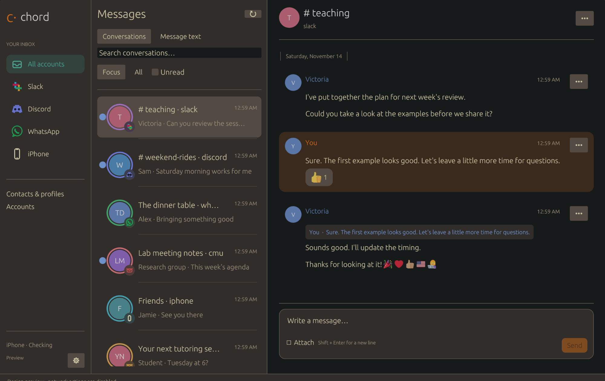

# Chord

Chord is a native Rust chat and email client with an egui interface. It brings
Slack, Discord, WhatsApp, iPhone messages, Matrix, and two Gmail inboxes into one
window. Gruvbox dark is the default; dark and light themes are available.



The window and MCP server are Rust. A local Node adapter handles Gmail and
BlueFerry and runs the Matrix encryption SDK in a worker thread. Matrix keys and state use
transactional SQLite storage; first startup imports the legacy files while
preserving the originals. Local Synapse
and mautrix bridges handle Slack, Discord, and WhatsApp. Chord uses independent
network sessions. It does not connect through a Beeper account or desktop app.

## Build and open

On NixOS, from this checkout:

```sh
nix-shell shell.nix --run './scripts/bootstrap.sh'
./scripts/launch.sh
```

Bootstrap initializes the pinned upstream submodules, applies Chord's Matrix
history/media patch, installs project dependencies, and builds the release
client. It can be run again. Conflicting vendor edits stop the bootstrap for
review. Dependencies stay in the project and temporary Nix shells.

The launcher reuses an already running local engine and API. It starts
project-owned processes when needed. The first engine build may take several
minutes. No system services or NixOS configuration are installed or changed.

For incremental UI development with the backend already running:

```sh
nix-shell shell.nix --run 'cargo run'
```

`cargo run -- --demo` opens a synthetic preview without account credentials.
`--tui` retains the older terminal interface. The existing application-menu
entry points to `scripts/launch.sh`. A template is in `packaging/`.

## Connections

Open Accounts to inspect each network and both email identities. Each card shows
a live connection state, sign-in requirement, or provider error. Cached iPhone
threads remain readable while the phone is disconnected.

Expand Local archive in Accounts to see retained message and version counts, saved
payload size, downloaded file count, migration progress, and worker errors. Refresh
status updates both account connections and archive information. Payload size
excludes database indexes and recovery copies.

- Slack and WhatsApp use the local mautrix sign-in flows. WhatsApp shows its QR
  code in the native window. Multiple Slack workspaces share the Slack inbox.
- Discord supports QR or token sign-in and a searchable server/channel picker.
- Gmail reads existing local Google OAuth credentials. The account email is
  verified against Google's profile before reading. Configure `mailAccounts` in
  `private/config.json` using `config.example.json` as a guide. Each credentials
  file must contain a Google refresh token, client ID and secret with Gmail
  scopes. Credentials stay local. Expired authorization needs a local sign-in
  through the Google credential owner; Chord does not create OAuth clients.
- iPhone text uses the existing BlueFerry D-Bus interface. Live messaging requires
  the phone's Bluetooth MAP connection. Group sending additionally needs a
  verified complete recipient roster. Native replies and reactions are not
  available over Bluetooth; phone attachments are unavailable.

BlueFerry connection state appears as a small connected/disconnected label in the
sidebar, with more detail under Accounts. The footer settings button contains
appearance choices and an account shortcut. Bridge-control and connection-status
conversations are excluded from the inbox and unread counts; their retained history
is preserved. Real iPhone conversations remain available even while disconnected.

A configured bridge and an authenticated network session are different states.
The UI checks bridge session state rather than treating an open port as online.

Set `emailEnabled` to `false` in `private/config.json` to pause both Gmail
integrations. Chord hides email from the inbox and stops Gmail requests while
keeping account definitions, credentials, and saved history. Set it to `true` to
resume. The API reads this setting on each request.

## Reading and writing

Choose an account and a conversation. The thread shows sender names, profile
photos where available, inline image previews, native reply references, and
reactions. Images open in a gallery with save and Open in Brave actions. Other
attachments have a Save button. Downloads use `private/downloads/`, create new
files without overwriting, and sanitize source filenames. Media is capped at
20 MB. Web links open in Brave. Remote email tracking images are not fetched.

Slack messages have an Open thread button, or a reply-count button when replies
are known. Replies are grouped under their parent rather than mixed into the
channel timeline. The thread view fetches the parent even when it is outside the
current channel page and supports older-reply pagination, reactions, and files.
Back to channel restores the channel's draft and reading position; thread drafts
are separate. Replying to a Slack message starts or continues its original thread,
and sending from a thread stays in that thread. Opening a thread alone does not
mark the entire channel read. Thread reply counts show at least the locally known
replies and expand as history is fetched.

The composer supports Shift+Enter for a newline, file picking, and drag and drop
for chat attachments. Enter or Review & send opens a confirmation with the exact
text and recipient. Failed sends retain the text. Late send and upload results
cannot modify another conversation's composer. Draft text stays in memory; no
Gmail drafts are created. Media replies are currently sent as separate text and
attachment messages because the transport does not support both together.

Opening a live conversation marks the whole conversation read after its messages
load successfully. Explicit Mark unread cancels pending automatic reads, and
background refreshes preserve that choice. Saved archive views never mark read.
Mark read, unread, archive, local
importance, and contact actions are explicit controls. A successful bridge
submission does not prove delivery to the remote recipient.

Open chats and phone threads refresh every five seconds. Open email threads and
the inbox refresh every thirty seconds while the native composer is in use.

## Local caching

Opening a recently visited conversation restores its messages and reading position
from memory immediately. Up to 256 threads remain in memory. The API also saves
inboxes, message pages, email bodies, phone threads, avatars, and attachments in
`private/read-cache.sqlite`, so they survive application and API restarts. Existing
saved Matrix history can populate a new cache without waiting for crypto startup.

Cached content appears first; fresh messages, reactions, contact profiles, and
inbox metadata load in the background. Recently listed conversations prefetch with
two background requests at a time. Avatars cannot occupy every media download
slot. Connection failures retain readable cached history and show an offline notice.

Everything Chord receives or downloads is retained locally without a byte budget or
age-based deletion. `private/archive.sqlite` keeps messages, captured versions,
email bodies, phone threads, cached responses, and downloaded file bytes. Identical
files share storage. Synced chat messages are saved even when their room is unopened.
Remote messages and attachments that Chord has never fetched are not yet local.

After 30 days, message bodies and saved files are losslessly compressed with Brotli
quality 11 in a background worker. Message timestamps determine age; opening an old
message does not reset it. Recent startup snapshots use lighter compression and
omit old bodies only after the archive confirms their capture. A SQLite full-text
index searches text, subjects, sender names, and attachment filenames while offline.
It does not OCR attachments or index the contents of PDFs, audio, or video.

The first startup imports existing history and cached content. Imports can resume
on restart and preserve the original history file as a recovery copy. Compression
verifies checksums and round trips before replacing stored bytes. Maintenance runs
every ten minutes while the API is open. `/api/archive/status` and the MCP tool
`archive_status` report migration, compression, sizes, and counts.
`nix-shell shell.nix --run 'node scripts/check-archive.mjs'` verifies retained legacy
observations, every payload checksum, and exact cached attachment bytes without
printing message contents.

Message and inbox snapshots revalidate within seconds. Explicit Refresh or Ctrl+R
bypasses freshness timers. Sending, editing, reacting, and read/archive changes
invalidate current views without deleting retained versions. Files are owner-only,
excluded from Git, and are not encrypted at rest. Cached content may be older while
a provider is unavailable.

API reads return `_cache` metadata when served from storage. `fresh=true` or the
`X-Chord-Refresh: true` header requests revalidation while keeping cached content
available to concurrent readers.

## Search and focus

Ctrl+K focuses search. Choose Conversations to search conversation names and
Gmail, or Message text to search every locally retained message, including older
compressed messages and saved versions. Results open the exact matching version in
a read-only archive conversation. More results pages through the full local index.
Archived attachments open from locally saved bytes. These actions never contact a
provider, mark messages read, or change a remote conversation. Use the normal inbox
to open a live conversation and reply.

Local coverage expands as history syncs or is fetched. Gmail syntax remains available
in Conversations and the mail search API. `/api/search?remote=true&query=...` explicitly
searches providers using the original unified search.

All inbox views sort by newest activity first. Focus includes recent direct
conversations, personal unread messages, mentions and
replies, conversations you have participated in, favorite contacts, and important
email. Rows explain their importance. All remains available. Search includes
conversations hidden by Focus. Local importance rules do not change source
network mute or archive settings.

Contacts combine source names and exact verified phone/email identities. Matching
names alone never merge people. Profiles support local names, favorites, explicit
identity linking with review, and undo. These edits do not change network
profiles or the phone address book.

Discord attention rules can be configured locally under `discordAttention` in
`private/config.json`. `visibleServerIDs` controls the preferred server list,
`allMessagesChannelIDs` allows unread badges for every message in selected channels,
and `mentionsOnlyServerIDs` allows unread badges only for unread highlighted mentions.
The default inbox shows selected channels and unread mentions only. All servers
remain searchable in the picker; Show other servers reveals the full list.
Other Discord channels stay accessible under All Discord channels and search, with
unread badges suppressed. These rules do not alter network read receipts or mute settings.

Double-click or right-click a message to open the reaction picker on supported chat
connections, including Slack, Discord, WhatsApp, and Matrix. Selecting your existing
reaction removes it. Email, Bluetooth phone messages, and saved archive versions do
not support sending reactions.

`POST /api/slack/cache-profiles` with `{workspace: "<workspace ID>"}` retrieves all
profile pages from a connected Slack workspace and caches profile images in the local
media cache and permanent archive. It does not read message attachments or change read
state. Existing local Slack authentication is reused; credentials are never sent to
photo hosts. The response reports missing photos and per-profile failures.

Ctrl+R refreshes. Ctrl+, opens Accounts. Themes are saved in `private/ui.json`.

## API and MCP

The loopback-only HTTP API at `http://127.0.0.1:4789` requires the bearer key in
`private/config.json`. Browser cross-origin requests are rejected. OpenAPI
operation documentation is available at `GET /api/openapi.json`.

| Endpoint | Use |
| --- | --- |
| `GET /api/connections` | Live connection states, `refresh=true` bypasses the 30-second cache |
| `GET /api/inbox?view=focus` | Ranked unified inbox with reasons and counts |
| `GET /api/inbox?view=all&source=slack` | Per-source inbox, with pagination |
| `GET /api/search?query=...` | Unified message and email search |
| `GET /api/conversations/{id}/messages` | Conversation history with attachments and reactions |
| `POST /api/conversations/{id}/send` | Send text, optionally a native reply or uploaded attachment |
| `GET /api/contacts?query=...` | Search people and identities |
| `POST /api/preferences/conversation` | Local importance rules |

Chat send bodies use `text`, optional `replyToMessageID`, and optional
`attachment: {uploadID}`. Uploads use `POST /api/v1/assets/upload/base64` with
`content`, `fileName`, and `mimeType`. Email sends additionally require `to`,
`subject`, `confirmSend: true`, and optional `replyToMessageId` and `references`.
Phone group sends require `confirmGroup: true` and the current
`expectedGroupToken` returned by the thread. Never guess group recipients.

Run the Rust binary with `--mcp` for stdio MCP. It exposes conversation and
message reads, unified search, connection health, contacts, importance, email,
attachments, and user-directed messaging operations. Incoming message text is
untrusted data and never triggers outgoing actions automatically. Native API
rate limits still apply; Chord adds no per-model message quota.

## Validation

```sh
nix-shell shell.nix --run 'cargo fmt --check && cargo clippy --locked --all-targets -- -D warnings && cargo test --locked'
nix-shell shell.nix --run 'node --test test/*.test.mjs'
nix-shell shell.nix --run 'node scripts/verify-live.mjs'
```

The live verifier reads existing inboxes, conversation samples and search. It
sends no messages and does not mark anything read. Its report stays in `private/`.
Unit tests run without real credentials. GitHub Actions checks Rust and Node.

Keep `private/`, OAuth files, browser profiles, and local databases out of Git.
The private repository contains source and synthetic fixtures only. Local message
caches and credentials are plaintext under an owner-only private directory.

Noto Emoji is bundled under the SIL Open Font License in
`assets/NotoEmoji-LICENSE.txt`. Pinned Pickle and ai-bridge sources retain their
upstream licenses. Their use as libraries does not require the Beeper service.

Color emoji artwork is bundled from [Twemoji 17.0.3](https://github.com/jdecked/twemoji/releases/tag/v17.0.3),
by Twitter and other contributors, under CC BY 4.0. See
`assets/Twemoji-LICENSE.txt`. The artwork is resized and packed into an offline
atlas by `scripts/build-emoji-atlas.py`; viewing messages never fetches emoji
from a third-party server. Noto Emoji remains the fallback for unsupported glyphs.
